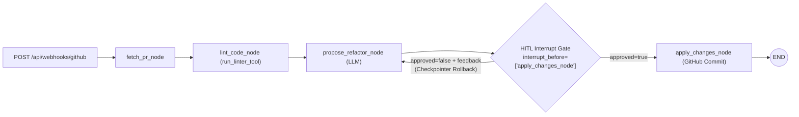

# Code Review & Refactoring Agent with LangGraph

- **Repository**: [Insert URL]
- **Core Stack**: Python, LangGraph, GitHub API, FastAPI, Docker, SQLite Checkpointer (`SqliteSaver` / `MemorySaver`)

An autonomous Pull Request code review and refactoring agent built with **LangGraph** and **FastAPI**. It ingests GitHub Pull Request webhooks, analyzes Python source files inside an isolated linting sandbox (`flake8` + `black --check`), proposes LLM-powered refactors, pauses at a **Human-in-the-Loop (HITL)** approval gate before any repository write, supports **reviewer feedback rollback loops**, and commits approved changes back to the PR branch via the GitHub REST API.

---

## Architecture



### LangGraph State Schema (`ReviewState`)

| Key | Type | Purpose |
| --- | --- | --- |
| `pr_url` | `str` | Target Pull Request or repository URL |
| `code_contents` | `dict[str, str]` | Modified PR files fetched from GitHub |
| `lint_errors` | `dict[str, str]` | Per-file sandbox `flake8` & `black --check` diagnostics |
| `refactored_code` | `dict[str, str]` | Proposed refactored code blocks |
| `is_approved` | `Optional[bool]` | Human reviewer approval flag (`None` while paused) |
| `reviewer_feedback` | `Optional[str]` | Reviewer instructions applied on rollback regeneration |
| `history` | `list[dict]` | Append-only audit log of node transitions & review decisions |

---

## Project Structure

```text
autonomous-code-reviewagent/
├── app/
│   ├── api/
│   │   ├── routes.py            # FastAPI webhook, HITL approval, and thread inspection endpoints
│   │   └── schemas.py           # Strict Pydantic v2 request & response schemas
│   ├── graph/
│   │   ├── checkpointer.py      # SqliteSaver / MemorySaver persistence factory
│   │   ├── nodes.py             # fetch_pr_node, lint_code_node, propose_refactor_node, apply_changes_node
│   │   ├── state.py             # ReviewState TypedDict
│   │   └── workflow.py          # StateGraph with interrupt_before & rollback orchestrator
│   ├── services/
│   │   ├── github_client.py     # GitHub REST API client (fetch PR files + commit write-back)
│   │   └── refactor_engine.py   # ChatOpenAI refactoring engine + offline deterministic fallback
│   ├── tools/
│   │   └── sandbox_linter.py    # Custom @tool run_linter_tool (isolated tempfile + flake8/black)
│   ├── config.py                # Environment & YAML settings loader
│   ├── logging_config.py        # Structured logging setup
│   └── main.py                  # FastAPI application factory
├── configs/
│   ├── .flake8                  # Flake8 configuration used by the sandbox linter
│   └── pipeline.yaml            # Pipeline, sandbox, and checkpointer defaults
├── scripts/
│   └── export_openapi.py        # Regenerate openapi.json from FastAPI
├── tests/
│   ├── conftest.py              # Shared fixtures & TestClient
│   ├── test_api_endpoints.py    # FastAPI endpoints, Test Cases 1-3, and 422/404 validation tests
│   ├── test_github_client.py    # GitHub API PR fetch & commit write-back tests
│   ├── test_graph_routing.py    # Checkpointer rollback assertions & SqliteSaver persistence tests
│   └── test_sandbox_linter.py   # Lint tool isolation & syntax error detection tests
├── .env.example                 # Environment variable template (secrets isolated)
├── Dockerfile                   # Container image build
├── docker-compose.yml           # Local Docker orchestration with persistent SQLite volume
├── main.py                      # Root entrypoint for `uvicorn main:app --reload`
├── openapi.json                 # Exported OpenAPI 3.1 specification
├── pyproject.toml               # pytest & black settings
└── requirements.txt             # Python dependencies
```

---

## Installation

1. Configure `.env` file (`GITHUB_TOKEN`, `OPENAI_API_KEY`):
   ```bash
   cp .env.example .env
   ```
   Edit `.env` with your credentials:
   - `GITHUB_TOKEN`: Personal Access Token with `repo` scope (for live PR reads & commits)
   - `OPENAI_API_KEY`: OpenAI API key for LLM-assisted refactoring via `ChatOpenAI`
   - `CHECKPOINTER_TYPE`: `sqlite` (default persistent storage) or `memory`
   - `DRY_RUN_MODE`: Set `false` for real GitHub commits, or `true` for safe local webhook simulations without live tokens

2. Create a virtual environment (recommended) and install dependencies:
   ```bash
   python -m venv .venv
   # Windows PowerShell:
   .venv\Scripts\Activate.ps1
   # macOS / Linux:
   source .venv/bin/activate

   pip install -r requirements.txt
   ```

3. Run FastAPI:
   ```bash
   uvicorn main:app --reload
   ```
   Interactive Swagger docs are available at `http://localhost:8000/docs`, and the exported OpenAPI JSON spec is stored in `openapi.json`.

4. Run tests:
   ```bash
   pytest
   ```

---

## Verification & Validation Walkthrough

### Test Case 1: Webhook PR Ingestion, Linting, & HITL Pause Gate

Start the server with `uvicorn main:app --reload`, then send a mock PR webhook payload:

```bash
curl -X POST http://localhost:8000/api/webhooks/github \
  -H "Content-Type: application/json" \
  -d '{
    "repository_url": "https://github.com/acme/review-agent-demo",
    "branch": "feature/refactor-loops",
    "pr_number": 12
  }'
```

The server creates a new `thread_id`, fetches the PR files, runs `run_linter_tool` (`flake8` + `black --check`), generates the initial refactored code draft, and halts before `apply_changes_node` (`"status": "awaiting_approval"`, `"next_nodes": ["apply_changes_node"]`).

### Test Case 2: Feedback Input & Refactoring Proposal Re-route Loop

Submit a rejection with feedback using the returned `{thread_id}`:

```bash
curl -X POST http://localhost:8000/api/reviews/{thread_id}/approve \
  -H "Content-Type: application/json" \
  -d '{
    "approved": false,
    "feedback": "Use list comprehensions instead of loops"
  }'
```

The checkpointer records the feedback, rolls back the thread to `propose_refactor_node`, regenerates the refactored code incorporating list comprehensions, and pauses again at the `apply_changes_node` interrupt gate.

### Test Case 3: Approval & Git Commit Write-Back

Approve the updated refactoring draft:

```bash
curl -X POST http://localhost:8000/api/reviews/{thread_id}/approve \
  -H "Content-Type: application/json" \
  -d '{
    "approved": true
  }'
```

The agent resumes, executes `apply_changes_node`, commits the refactored code to the target GitHub branch, and completes the thread (`"status": "completed"`, `"next_nodes": []`).

---

## API Endpoints

| Method | Path | Description |
| --- | --- | --- |
| `POST` | `/api/webhooks/github` | Ingest GitHub PR webhook payload and start a new review thread |
| `POST` | `/api/reviews/{thread_id}/approve` | Approve (`approved: true`) or reject with feedback (`approved: false, feedback: "..."`) |
| `GET` | `/api/reviews/{thread_id}` | Inspect current persisted state of a review thread |
| `GET` | `/api/reviews/{thread_id}/history` | Inspect LangGraph checkpointer history snapshots |
| `GET` | `/api/reviews` | List active review threads |
| `GET` | `/health` | Service health check |

---

## Docker Usage

```bash
cp .env.example .env
docker compose up --build
```

The service listens on `http://localhost:8000` with SQLite checkpoints persisted in the `checkpoint_data` volume.

To regenerate the OpenAPI specification file after modifying routes or schemas:

```bash
python scripts/export_openapi.py
```
